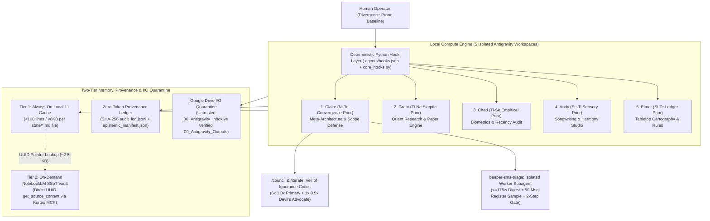

# Cognitive Function Based Agent Harness

**Deterministic Python Lifecycle Hooks, Two-Tier Memory Hydration, SHA-256 Hash-Chained Provenance, Adversarial Staged Iteration (`/iterate`), and a Rawlsian Veil-of-Ignorance Council (`/council`) for Multi-Workspace AI Agents.**

In plain English, this is a zero-dependency Python harness and multi-agent workspace architecture that keeps personal AI systems from turning into forgetful, agreeable yes-men. It runs five isolated daily workspaces (executive schedule and SMS triage, quantitative paper trading, physiological lab tracking, songwriting and vocal harmony charting, and tabletop RPG prep), using Python `PreToolUse` and `PostToolUse` hooks to block LLM prose slop, enforce hard statistical and clinical cutoffs, quarantine untrusted inputs, and stress-test decisions through an anonymized 7-seat adversarial council.

### Core Executable Modules (Inside `.agents/` & `tests/`)

Because Antigravity loads hooks, rules, and skills from the hidden [`.agents/`](./.agents/) directory, start with these files if you are browsing on GitHub:

| Module | Path | What It Enforces |
| :--- | :--- | :--- |
| **Shared Hook Kernel** | [`.agents/scripts/core_hooks.py`](./.agents/scripts/core_hooks.py) | `PreToolUse` file/shell locks, `lint_markdown_slop`, invisible Unicode/prompt-injection defense, CaMeL taint decay, Kortex MCP rewrites, and `fcntl.flock` SHA-256 audit logging |
| **Orchestrator Hooks** | [`.agents/scripts/claire_hooks.py`](./.agents/scripts/claire_hooks.py) | Outbound SMS/RCS MCP block, shared calendar & NotebookLM Vault optimistic concurrency (OCC) checks, and `SessionStart` state-cap/UUID topology auditor |
| **Provenance & Token CLI** | [`.agents/scripts/audit_log.py`](./.agents/scripts/audit_log.py) | SHA-256 hash-chain verifier (`verify -a`), bitemporal L1/Vault epistemic check (`epistemic --check`), ADR recorder, and Turn-0 token telemetry (`tokens`) |
| **Clean-Room Staging Engine** | [`.agents/skills/iterate/scripts/iterate_stage.py`](./.agents/skills/iterate/scripts/iterate_stage.py) | Isolated sandbox mirroring, runtime `PRE_TOOL_BLOCK` trace export, and round snapshot validation for `/iterate` |
| **SMS Quarantine & Gate CLI** | [`.agents/skills/beeper-sms-triage/scripts/beeper_triage.py`](./.agents/skills/beeper-sms-triage/scripts/beeper_triage.py) | Local Beeper Desktop PKCE OAuth, 50-message outgoing voice sampler, and two-step `stage-reply` -> `send-staged` confirmation gate |
| **Anti-Slop Voice Rules** | [`.agents/rules/human-voice.md`](./.agents/rules/human-voice.md) | Banned punctuation (em/en dashes), banned rhetorical contrast frames, and banned AI filler vocabulary enforced at write time |
| **Automated Test Suite** | [`tests/test_hooks_and_invariants.py`](./tests/test_hooks_and_invariants.py) | 13 zero-dependency unit tests covering every hook lock, anti-slop rule, MCP rewrite, CLI subcommand, and zero-PII invariant |

---

## Quick Verification (Zero Dependencies, Python 3.9+)

Clone the repository and run the automated verification suite to test the `PreToolUse` security locks (`core_hooks.py` and `claire_hooks.py`), the `lint_markdown_slop` payload gate, the Kortex MCP argument rewriter, the Beeper SMS outbound gate, the `SessionStart` state-cap and UUID topology auditor, `<scope>-<mbti>` persona/panel congruence, and repository-wide zero-PII compliance:

```bash
python3 -m unittest discover -s tests -v
python3 .agents/scripts/claire_hooks.py SessionStart
python3 .agents/scripts/audit_log.py tokens
python3 .agents/scripts/audit_log.py verify -a
python3 .agents/scripts/audit_log.py epistemic --check
python3 .agents/scripts/audit_log.py summary
```

---

## 1. Harness Thesis

Most production agent setups fail in one of two ways. Either an operator stuffs ten thousand words of rules, domain lore, and behavioral wishes into a single monolithic system prompt until context drift turns the model into an agreeable yes-man, or an engineering team wraps brittle orchestration chains around fuzzy vector search that strips away document structure and burns tens of thousands of tokens per turn.

This repository documents an executable multi-workspace agent harness run inside Google Antigravity. It treats **operator distraction**, **model sycophancy**, **context drift**, **prose slop**, and **epistemic staleness** as systems engineering problems solved through five mechanisms:

1. **Deterministic Python Interception Over Prompt Wishing (`PreToolUse`, `PostToolUse`, & `SessionStart`):** Security, token-conservation, provenance, and anti-slop rules are enforced outside the LLM reasoning loop via [`.agents/hooks.json`](./.agents/hooks.json), the shared kernel [`.agents/scripts/core_hooks.py`](./.agents/scripts/core_hooks.py), and workspace-specific hooks ([`.agents/scripts/claire_hooks.py`](./.agents/scripts/claire_hooks.py)). Before any file write, shell command, or MCP tool call executes, Python hooks block unauthorized edits to locked files, reject Markdown writes containing LLM punctuation or filler vocabulary, block unsupervised outbound SMS/RCS transmissions, enforce CaMeL untrusted-input taint gates, and rewrite NotebookLM MCP payloads to strip citation bloat.
2. **Two-Tier Memory Hydration (`<100`-Line L1 Cache + UUID-Indexed L2 Vault):** Every workspace hydrates a compact local Markdown routing cache (`<100` lines and `<8,000` bytes per file in [`state/`](./state/)) at Turn 0 with zero tool calls, holding exact UUID pointers into canonical Single-Source-of-Truth (`00_STATE_`) documents stored in Google NotebookLM (via Kortex MCP) and local L2 archives. Across all five workspaces combined, the entire setup consumes **~23,309 Turn-0 tokens** (see [`FRAMEWORK_CHANGELOG.md`](./FRAMEWORK_CHANGELOG.md)).
3. **Zero-Token SHA-256 Hash-Chained Provenance & Bitemporal Epistemic Engine ([`audit_log.py`](./.agents/scripts/audit_log.py)):** Every file edit, command, subagent dispatch, and Vault sync is automatically recorded in `PostToolUse` to an `fcntl.flock`-serialized, SHA-256 hash-chained ledger (`state/audit_log.jsonl`) and an $O(1)$ epistemic manifest (`state/epistemic_manifest.json`) tracking optimistic concurrency (OCC) reads, exogenous lookup authority tiers, and out-of-band Vault drift.
4. **Antagonistic Prompt Priors Indexed by Cognitive-Function Shorthand:** Execution is split across five isolated workspaces (`claire-architect`, `grant`, `chad`, `andy`, `elmer`). Jungian cognitive-function labels (`Ni-Te`, `Ti-Ne`, `Ti-Se`, `Se-Ti`, `Si-Te`) and Enneagram structures are used strictly as **compact heuristic compression labels for antagonistic behavioral priors** under an explicit **`Observed Reality > Typology Heuristic`** precedence rule, while hard invariants are enforced by Python hooks and numeric gates.
5. **Rawlsian Veil-of-Ignorance Council ([`/council`](./.agents/skills/council/SKILL.md)) & Clean-Room Staged Iteration ([`/iterate`](./.agents/skills/iterate/SKILL.md)):** High-stakes architectural decisions and code changes are stress-tested in isolated staging sandboxes (`iterate_stage.py`) by fresh clean-room critic subagents (`<scope>-<mbti>`) operating under an anonymized `<150`-word bailiff brief stripped of user identity and prior round history.

---

## 2. Harness Topology



For full character and token telemetry across all five workspaces, see [`FRAMEWORK_CHANGELOG.md`](./FRAMEWORK_CHANGELOG.md).

---

## 3. Core Harness Engineering Pillars

### Pillar 1: Deterministic Python Lifecycle Hooks (`PreToolUse`, `PostToolUse`, & `SessionStart`)

Asking an LLM in Markdown to remember tool arguments, obey style guides, or leave core config files alone fails over long trajectories. In this harness, [`core_hooks.py`](./.agents/scripts/core_hooks.py), [`claire_hooks.py`](./.agents/scripts/claire_hooks.py), and [`hooks.json`](./.agents/hooks.json) enforce operational invariants deterministically in Python:

1. **Core Architecture Lock (`PreToolUse` File & Shell Guard):** If an agent attempts to call `edit_file`, `write_file`, or a mutating `run_command` shell pipeline on any locked identity, rule, skill, or hook file, `evaluate_base_pre_tool_use` inspects `lastUserInput`. Unless the human operator's prompt begins with `[<Agent> Debug Mode]`, the hook returns `{"decision": "deny"}` before the file system is touched and logs a `PRE_TOOL_BLOCK` trace to `state/audit_log.jsonl`.
2. **Preventive Anti-Slop & Invisible Unicode Gate (`lint_markdown_slop` & `lint_security_payload` in `PreToolUse`):** Whenever an agent writes or edits any file, `core_hooks.py` scans the payload (including `ReplacementChunks`) before it hits disk. It rejects hidden zero-width/bidi/Unicode Tag characters (`U+E0000..U+E007F`), stored prompt-injection overrides, em dashes (`\u2014`), en dashes (`\u2013`), unparsed bracketed decimal weights, negative-positive contrast formulas, and banned AI filler vocabulary (defined in [`human-voice.md`](./.agents/rules/human-voice.md)).
3. **CaMeL Taint & Optimistic Concurrency Gates (`PreToolUse`):** Conversations that ingest untrusted external content (`00_Antigravity_Inbox` or inbound SMS) are tagged with turn-scoped CaMeL taint in `state/epistemic_manifest.json`, blocking unauthorized network exfiltration or package-install commands (`curl`, `wget`, `pip install`, `npm install`, `git push`). Similarly, mutating the shared calendar or canonical NotebookLM `00_STATE_` sources is blocked unless the target calendar or Vault UUID has been read within the current session.
4. **Outbound SMS/RCS Two-Step Confirmation Gate (`PreToolUse`):** Direct `call_mcp_tool(ServerName="beeper", ToolName="send_message")` calls are deterministically blocked, forcing all outbound messages through [`beeper_triage.py`](./.agents/skills/beeper-sms-triage/scripts/beeper_triage.py) (`stage-reply` -> next-turn human approval -> `send-staged --approval-id RPL-xxxxxx`), complete with stale-draft race detection if the recipient texts back after staging.
5. **Transparent MCP Payload Rewriting & `SessionStart` Auditing:** When the agent invokes `call_mcp_tool` targeting the `kortex` NotebookLM MCP server, `PreToolUse` injects `citation_format: "none"` on `ask_question` calls and the default `account`. At `SessionStart`, `claire_hooks.py` checks line/byte caps, staleness windows (supporting `CLAIRE_REFERENCE_DATE` for deterministic testing), and UUID parity between `state/ecosystem_registry.md` and `core_hooks.py`.

---

### Pillar 2: Two-Tier Memory Hydration, SHA-256 Provenance, & Subagent Quarantine

To prevent context-window bloat while preserving exact document fidelity, state is split into two tiers backed by an automatic provenance ledger and disposable worker subagents:

- **Tier 1 (Always-On Local L1 Routing Cache):** Three Markdown files in [`state/`](./state/) (`ecosystem_registry.md`, `routing_matrix.md`, `active_sprint.md`), each capped under 100 lines and 8,000 bytes, are expanded inline at Turn 0 via `@` file hydration (see [`.agents/rules/state-hydration-example.md`](./.agents/rules/state-hydration-example.md)).
- **Tier 2 (On-Demand Canonical Vault & SHA-256 Audit Ledger):** Deep domain state lives in Google NotebookLM notebooks anchored by synthesized `00_STATE_` / `01_STATE_` Markdown sources (`~2-5 KB` each), while local provenance lives in `state/audit_log.jsonl` and [`state/archive_decisions.md`](./state/archive_decisions.md), queried on demand via [`.agents/scripts/audit_log.py`](./.agents/scripts/audit_log.py) (`query|summary|changelog|verify|record-adr|epistemic|tokens`).
- **Subagent Context Quarantine ([`beeper-sms-triage`](./.agents/skills/beeper-sms-triage/SKILL.md)):** High-volume local API payloads (such as 24-hour SMS/RCS thread sweeps and 50-message per-thread outgoing style samples from Beeper Desktop at `localhost:23373`) are delegated to an isolated `sms-triage-worker` subagent (`EnableMCPTools: false`) that absorbs the raw JSON and returns a `<=175`-word actionable digest to the lead agent.

---

### Pillar 3: Antagonistic Prompt Priors Across Five Isolated Workspaces

Standard helpful-assistant personas collapse into agreeableness under operator pressure. Here, each domain workspace pairs an explicit control-loop prior against specific operator failure modes (rapid context-switching, skipping low-stimulus wrap-up, and late-night scope creep):

- **Meta-Architecture (`Claire`, `Ni-Te` Convergence Prior):** Counters lateral branching with a **Six-Month Trajectory Filter**, **Productive-Procrastination Detection** (catching when the operator pitches a complex new build to avoid a 10-minute wrap-up task in `active_sprint.md`), and a **Two-Volley Debate Cap** (settling Turn-3 disagreements with a 15-minute empirical benchmark). See [`workspaces/01_claire_architect_INTJ.md`](./workspaces/01_claire_architect_INTJ.md).
- **Quantitative Research (`Grant`, `Ti-Ne` Skeptic Prior):** Enforces a **Two-Stage Anti-Overfitting Funnel** on a `60/40` In-Sample / Out-of-Sample split (`>= 2 bps` slippage deducted): **Stage 1 Falsification (`N >= 25` OOS trades, `PF >= 1.25`)** acts strictly as an early filter to reject negative-expectancy retail setups (`t-stat < 1.0`), qualifying surviving models only for forward paper quarantine (`data/paper_ledger.json`, fixed-fractional `1R` risk sizing), while **Stage 2 Statistical Power (`N >= 100` cumulative trades + Model Graveyard Deflated Sharpe)** is required before any model is considered statistically significant. See [`workspaces/02_grant_quant_INTP.md`](./workspaces/02_grant_quant_INTP.md).
- **Biometrics & Physiology (`Chad`, `Ti-Se` Empirical Recency Prior):** Enforces hard rolling epistemic recency cutoffs on physiological telemetry (`<= 180d` active bloodwork, `181-365d` aging, `> 365d` expired scans/labs excluded from active decisions, and a **28-day perishable stability cutoff** audited at `SessionStart`). See [`workspaces/03_chad_biometrics_ISTP.md`](./workspaces/03_chad_biometrics_ISTP.md).
- **Songwriting & Harmony Studio (`Andy`, `Se-Ti` Sensory Convergence Prior):** Counters conceptual sprawl using acoustic/rhythmic constraints and deterministic music-theory invariants (rendering all vocal melodies on a standard `EADGBE` guitar grid and automatically inverting upper-register harmonies below the lead to stay within the target vocal pocket). See [`workspaces/04_andy_studio_ESTP.md`](./workspaces/04_andy_studio_ESTP.md).
- **Tabletop Cartography & Campaign Ops (`Elmer`, `Si-Te` Ledger Prior):** Guards institutional memory and session prep via a **Hot/Warm Two-Tier Vault Sync**, Kortex bucket shorthand expansion, and a zero-dependency ISO 32000 PDF 1.4 `1.00-inch` (`72.0 pt`) battle-map compiler. See [`workspaces/05_elmer_tabletop_ISTJ.md`](./workspaces/05_elmer_tabletop_ISTJ.md).

---

### Pillar 4: The Veil-of-Ignorance Council ([`/council`](./.agents/skills/council/SKILL.md)) & Adversarial Staged Iteration ([`/iterate`](./.agents/skills/iterate/SKILL.md))

When an operator asks a personalized AI assistant to evaluate a major decision or code change, the assistant knows the operator's identity and prior conversational history. The `/council` and `/iterate` skills eliminate sycophancy and rubber-stamping:

1. **The Anonymized Bailiff Brief (`<150` Words) & Clean-Room Staging (`iterate_stage.py`):** Target files are mirrored into `<artifact_dir>/scratch/iterate_stage/current/` alongside recent runtime `PRE_TOOL_BLOCK` failure traces. The lead architect strips all personal names, cognitive typology labels, and prior round history, presenting the staged directory to fresh critics as if it were the current live build.
2. **Zero-Tool `<scope>-<mbti>` Critic Subagents:** Seven council seats (or 3-seat domain panels in `grant`, `chad`, `andy`, and `elmer`) are registered via `define_subagent` with `EnableMCPTools: false`, `EnableWriteTools: false`, and `EnableSubagentTools: false`, and dispatched in parallel via `invoke_subagent`:
   - **Rational Wing (`1.0x` weight each):** `council-intj` (6-to-36-month structural degradation), `council-intp` (hidden premises, statistical power & survivorship bias), `council-entj` (14-day ROI, execution paths & opportunity cost).
   - **Human & Somatic Wing (`1.0x` weight each):** `council-enfj` (reputational & interpersonal landing), `council-istj` (physical fatigue & tired-Tuesday maintenance base rates), `council-isfp` (where performative complexity masks avoidance).
   - **Mandatory Devil's Advocate Dissenter (`0.5x` weight):** `council-entp` (structural duty to invert the core premise and show how the plan's biggest apparent strength becomes a trap; elevated to `1.0x` whenever it catches a concrete flaw missed by the primary seats).
3. **125-Word Output Contract & Snapshot Verification:** Each seat replies in `<=125` words of plain paragraphs with zero pleasantries, stating: (1) the domain vulnerability, (2) the concrete real-world failure mode, and (3) the exact fix or cut. Fixes are applied in staging and verified by `iterate_stage.py snapshot-round` (`lint_markdown_slop`, `ast.parse`, and `json.loads`) before updating the portable Master Plan artifact.

---

## 4. Repository Layout

```text
Cognitive-Function-Based-Architecture/
├── README.md                                          # Harness thesis, topology, and verification
├── FRAMEWORK_CHANGELOG.md                             # Single-source Turn-0 token telemetry & invariants
├── LICENSE                                            # MIT License
├── .gitignore                                         # Python bytecode, cache, and scratch exclusions
├── state/                                             # Mock <100-line L1 state caches audited by SessionStart
│   ├── active_sprint.md
│   ├── archive_decisions.md
│   ├── ecosystem_registry.md
│   └── routing_matrix.md
├── tests/
│   └── test_hooks_and_invariants.py                   # Automated unittest suite for hooks, congruence & zero-PII
├── .agents/
│   ├── hooks.json                                     # Antigravity SessionStart, PreToolUse & PostToolUse bindings
│   ├── rules/
│   │   ├── human-voice.md                             # Anti-LLM prose & anti-slop protocol
│   │   └── state-hydration-example.md                 # Turn-0 L1 cache hydration rule
│   ├── scripts/
│   │   ├── core_hooks.py                              # Shared security, anti-slop, CaMeL taint & SHA-256 kernel
│   │   ├── claire_hooks.py                            # Orchestrator locks, SMS/Calendar/Vault OCC & SessionStart
│   │   └── audit_log.py                               # Provenance query, hash-chain verifier, epistemic & token CLI
│   └── skills/
│       ├── agent-scaffolder/
│       │   ├── SKILL.md                               # Subagent generator skill specification
│       │   └── scripts/scaffold_agent.py              # CLI generator pre-wiring voice & Vault invariants
│       ├── beeper-sms-triage/
│       │   ├── SKILL.md                               # Subagent SMS quarantine, 50-msg style sample & 2-step gate
│       │   └── scripts/beeper_triage.py               # Beeper Desktop PKCE OAuth, triage, voice-sample & reply CLI
│       ├── council/
│       │   ├── SKILL.md                               # 7-seat Veil-of-Ignorance Council protocol (<scope>-<mbti>)
│       │   └── references/personas.md                 # Clean-room SystemPrompt specs for all 7 Council seats
│       └── iterate/
│           ├── SKILL.md                               # Adversarial Evaluate -> Plan -> Stage-Execute loop
│           ├── references/critic_panels.md            # All 19 <scope>-<mbti> Council & domain critic seats
│           └── scripts/iterate_stage.py               # Isolated staging, failure-trace export, snapshot & apply CLI
└── workspaces/
    ├── 01_claire_architect_INTJ.md                    # Meta-Architect (Ni-Te convergence counterweight)
    ├── 02_grant_quant_INTP.md                         # Quant Skeptic (Ti-Ne, Two-Stage 60/40 OOS funnel)
    ├── 03_chad_biometrics_ISTP.md                     # Physiology Auditor (Ti-Se, epistemic recency cutoffs)
    ├── 04_andy_studio_ESTP.md                         # Studio Producer (Se-Ti, acoustic rhythm & EADGBE vocal tabs)
    └── 05_elmer_tabletop_ISTJ.md                      # Tabletop Archivist (Si-Te, Hot/Warm Vault & 1.00-in PDF engine)
```
